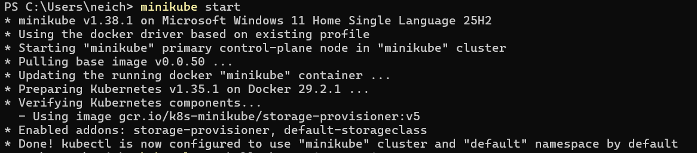
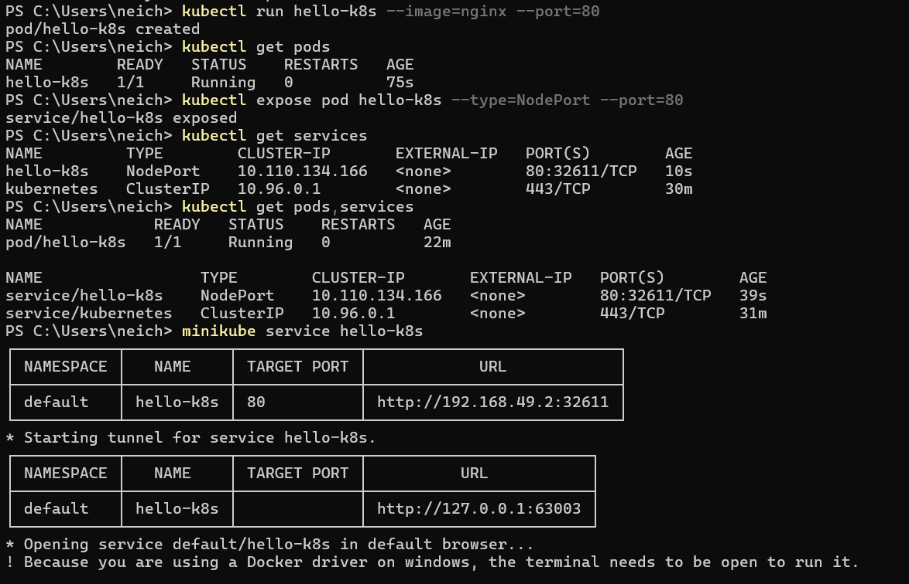
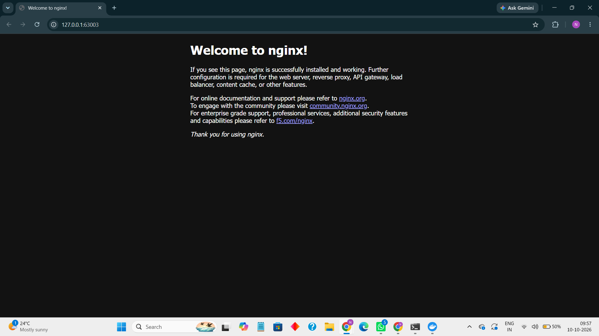

# Kubernetes Getting Started – Exercise 1: Hello Pod

## Overview

In this exercise, I learned how to deploy a simple web application on Kubernetes using Minikube. I used the Nginx container image to simulate a storefront and delivery-status page for Zepto.

The main objective was to understand how Kubernetes runs containers, how to expose an application using a Service, and how to access it through a web browser.

## Environment Used

- **Operating System:** Windows 11
- **Container Runtime:** Docker Desktop
- **Kubernetes Cluster:** Minikube
- **Command-Line Tool:** kubectl
- **Container Image:** Nginx

## Steps Performed

### 1. Started the Kubernetes Cluster

I started Minikube using Docker as the driver.

```bash
minikube start --driver=docker
```

This created a local Kubernetes cluster on my system.

### 2. Created the Nginx Pod

I deployed an Nginx container by running the following command:

```bash
kubectl run hello-k8s --image=nginx --port=80
```

This created a Pod named `hello-k8s`, which runs the Nginx web server.

### 3. Verified the Pod

I checked the Pod status using:

```bash
kubectl get pods
```

The Pod reached the `Running` state, confirming that the Nginx container was running successfully.

### 4. Exposed the Pod Using a Service

I created a NodePort Service to make the application accessible.

```bash
kubectl expose pod hello-k8s --type=NodePort --port=80
```

I verified the Pod and Service using:

```bash
kubectl get pods,services
```

### 5. Accessed the Application

Finally, I ran:

```bash
minikube service hello-k8s
```

This provided access to the application through my browser. The Nginx welcome page confirmed that the deployment was successful.

## Screenshots

### 1. Kubernetes Cluster Started


### 2. Nginx Pod Running, Pod and NodePort Service


### 3. Nginx Welcome Page


## Key Learnings

- Understood the basics of Kubernetes and Minikube.
- Learned how to create and verify a Pod using `kubectl`.
- Learned how a NodePort Service exposes an application.
- Accessed a containerized web application through a browser.

## Result

Successfully deployed the Nginx web server on a local Kubernetes cluster, exposed it using a NodePort Service, and accessed the application through a web browser.