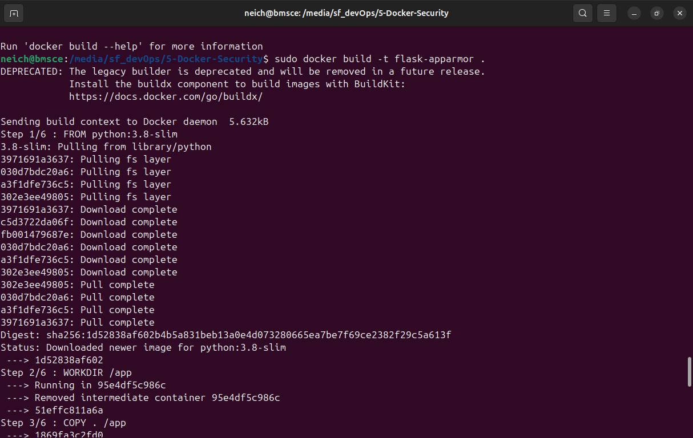
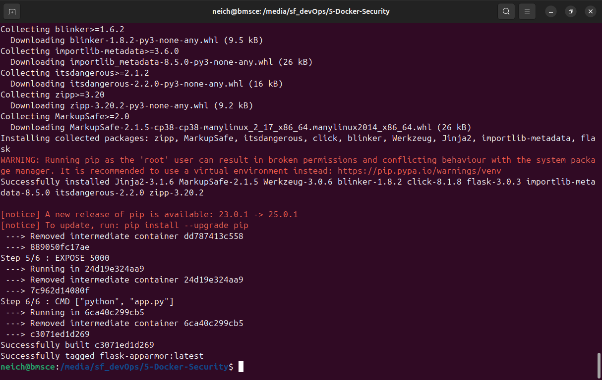
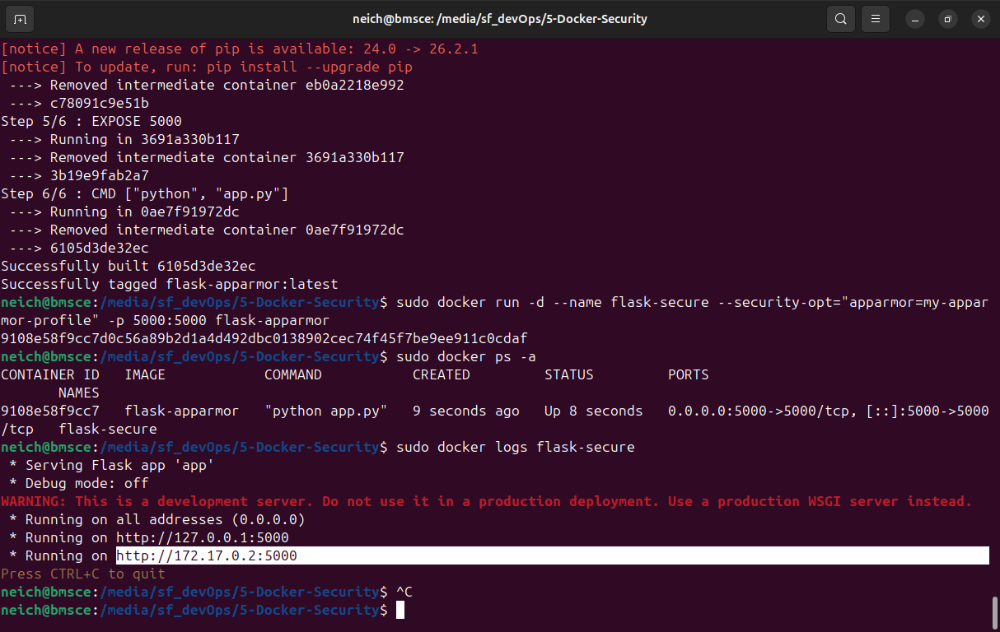
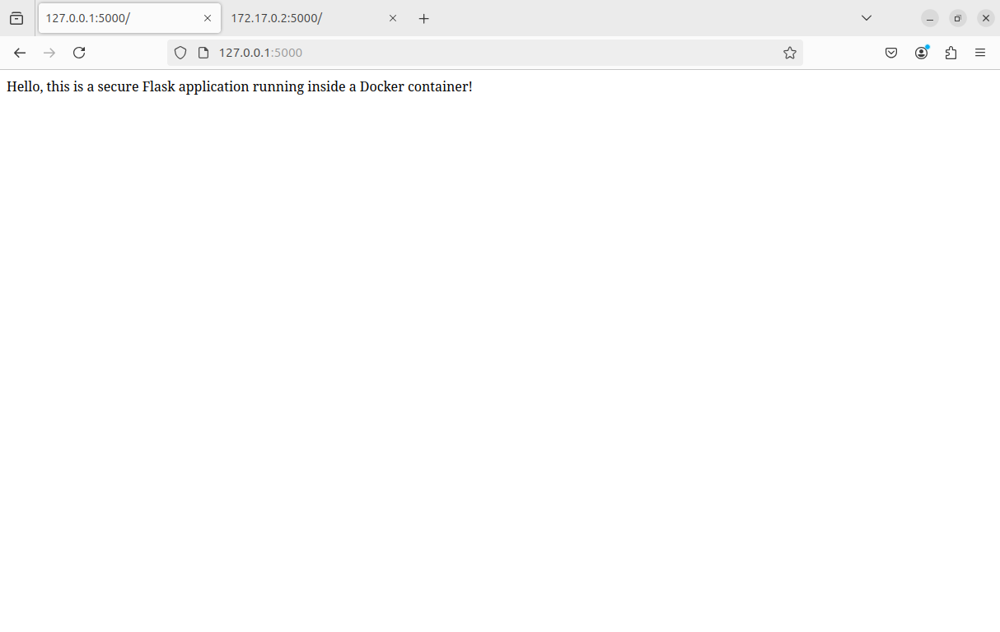
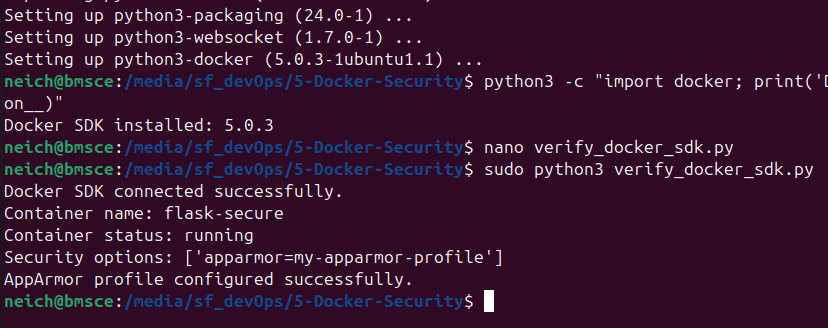
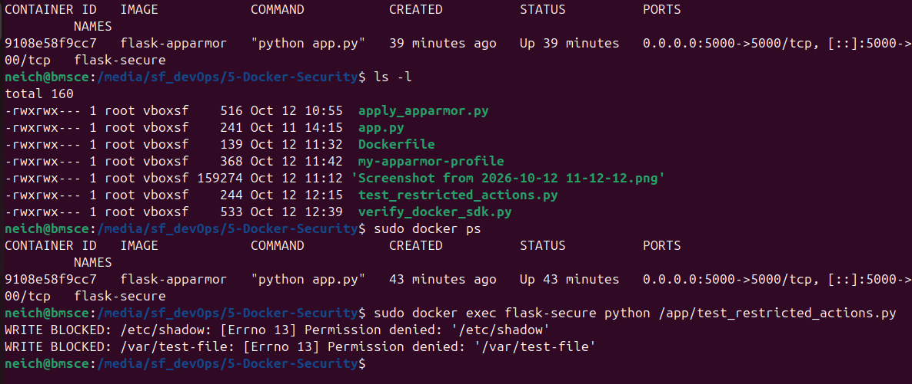

# Exercise 5: Docker Security with AppArmor and Python

## Objective
To enhance Docker container security using AppArmor profiles and Python Docker SDK verification. The exercise demonstrates how AppArmor restricts access to sensitive files and prevents unauthorized write operations inside a container.

## Environment
- **Operating System:** Ubuntu Linux
- **Container Platform:** Docker
- **Programming Language:** Python 3
- **Security Module:** AppArmor
- **Library:** Docker SDK for Python
- **Application Framework:** Flask

## Project Files
- `app.py` – Flask application.
- `Dockerfile` – Configuration for building the Docker image.
- `my-apparmor-profile` – AppArmor security rules for restricting file access and capabilities.
- `apply_apparmor.py` – Python script to load the AppArmor profile.
- `verify_docker_sdk.py` – Verifies Docker SDK connectivity, container status, and configured security options.
- `test_restricted_actions.py` – Tests whether restricted file-write operations are blocked.
- `README.md` – Project documentation.

## Implementation

### 1. Build the Docker Image
Build the Docker image using the Dockerfile:

```bash
sudo docker build -t flask-apparmor .
```

### 2. Load the AppArmor Profile
Load the custom AppArmor profile:

```bash
sudo python3 apply_apparmor.py
```

Verify that the profile is loaded:

```bash
sudo aa-status | grep my-apparmor-profile
```

### 3. Run the Secured Container
Start the Flask application with the custom AppArmor profile:

```bash
sudo docker run -d --name flask-secure \
  --security-opt="apparmor=my-apparmor-profile" \
  -p 5000:5000 flask-apparmor
```

The application can be accessed in a browser at:

- `http://127.0.0.1:5000`
- `http://localhost:5000`

### 4. Verify Docker SDK Configuration
Run the verification script:

```bash
sudo python3 verify_docker_sdk.py
```

The script checks Docker SDK connectivity, the container's running status, and its configured AppArmor security option.

### 5. Test Restricted Actions
Copy the test script into the running container and execute it:

```bash
sudo docker cp test_restricted_actions.py flask-secure:/app/
sudo docker exec flask-secure python /app/test_restricted_actions.py
```

The test attempts restricted write operations. Permission-denied errors indicate that the configured restrictions are blocking those operations.

## Results and Screenshots

### 1. Docker Image Build



### 2. AppArmor Profile and Container


### 3. Flask Application in Browser

The Flask application runs successfully inside the secured Docker container and is accessible through the browser.



### 4. Docker SDK Verification


### 5. Restricted Actions Test


## Key Learnings
- Learned how AppArmor profiles provide mandatory access control for Linux processes and containers.
- Understood how to apply a custom AppArmor profile to a Docker container.
- Used the Python Docker SDK to inspect container status and configured security options.
- Tested file-write restrictions and observed permission-denied errors.
- Understood how container security policies can reduce unauthorized access to sensitive resources.

## Conclusion
This exercise demonstrated the use of AppArmor to apply security restrictions to a Dockerized Flask application. The custom profile restricted selected file operations, while the Docker SDK verified the container's status and configured security options. The restricted-action tests showed that the attempted writes to protected locations were denied.

**Note:** Docker SDK verification confirms the configured security option; it does not independently prove that every AppArmor rule is enforced. Enforcement depends on the Linux host and its AppArmor configuration.
