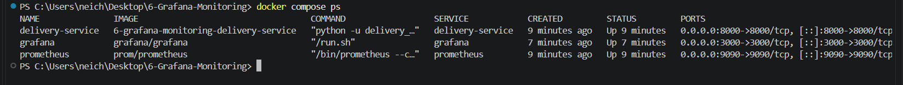
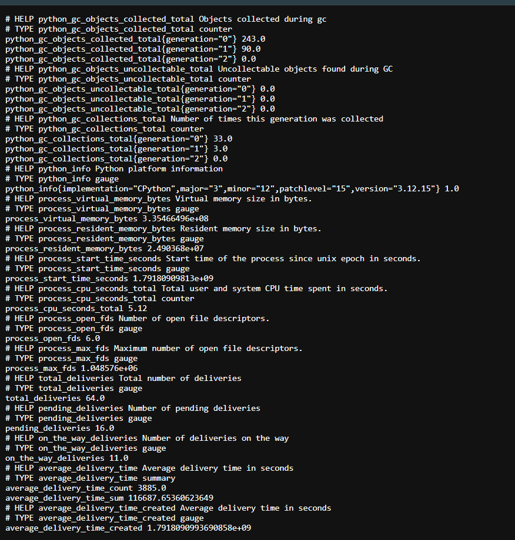
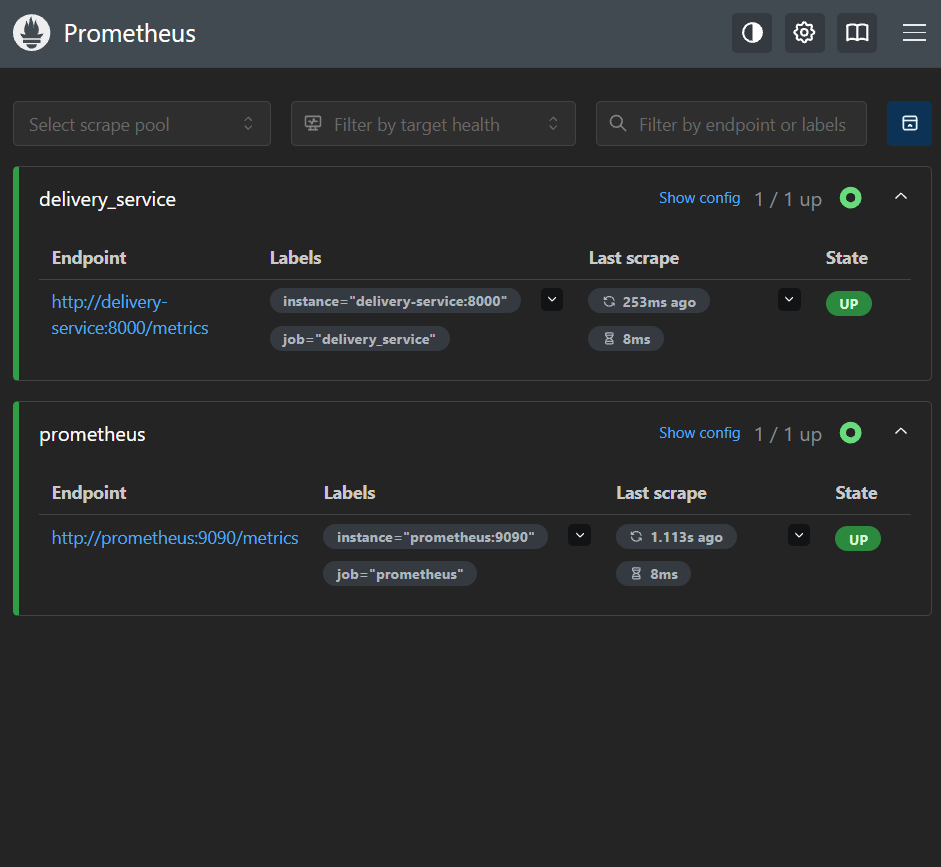
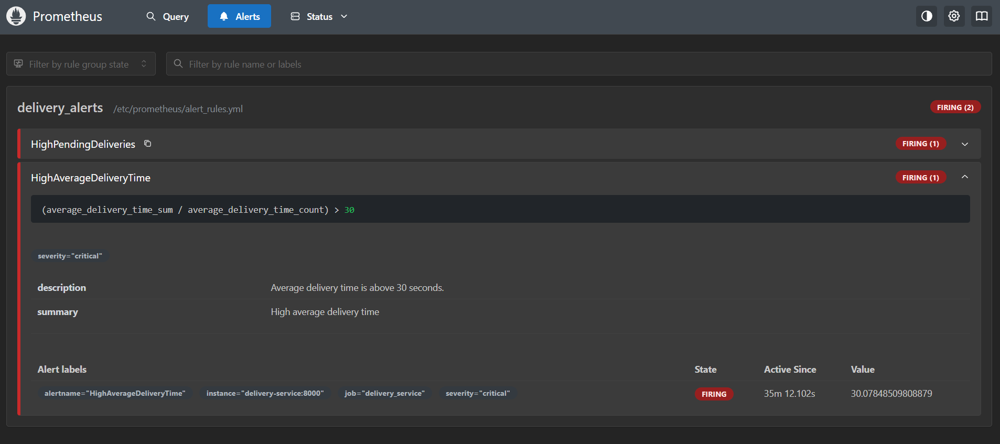
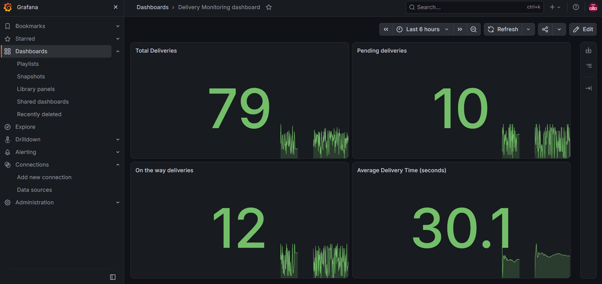
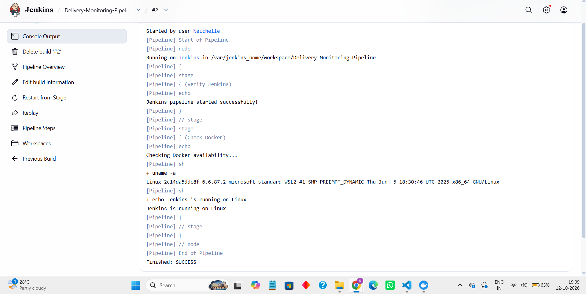

# Exercise 6: Grafana Monitoring and Alerting

## Objective

Monitor a delivery service using Prometheus and Grafana, visualize application metrics, configure alert rules, and verify the monitoring pipeline using Jenkins.

## Scenario

A delivery monitoring application consisting of three Docker containers:

- **Delivery Service** — Generates delivery metrics.
- **Prometheus** — Collects and evaluates metrics and alert rules.
- **Grafana** — Displays monitoring dashboards.

Jenkins is used to verify the monitoring setup through a pipeline.

## Environment

- **OS:** Windows 11 (AMD64), commands run in PowerShell
- **Engine:** Docker Desktop
- **Monitoring:** Prometheus and Grafana
- **CI/CD:** Jenkins

## Files

| File | Purpose |
|---|---|
| `delivery_service.py` | Runs the delivery application and exposes metrics |
| `prometheus.yml` | Configures Prometheus scraping targets |
| `alert_rules.yml` | Defines delivery monitoring alert rules |
| `docker-compose.yaml` | Configures and runs the monitoring containers |
| `Dockerfile` | Builds the delivery service image |
| `Jenkinsfile` | Defines the Jenkins verification pipeline |

## Tasks Performed

### 1. Start the monitoring application

Run the following command from the project directory in PowerShell:

```powershell
docker compose up -d --build
```

Verify that the containers are running:

```powershell
docker compose ps
```

**Expected result:** Delivery Service, Prometheus, and Grafana should be running.

### 2. Verify application metrics in the browser

Open:

`http://localhost:8000/metrics`

Verify that the page displays the application metrics, including delivery counters, pending deliveries, and delivery-time metrics.

**Screenshot:** `metrics-output.png`

### 3. Verify Prometheus targets

Open:

`http://localhost:9090/targets`

Check that the `delivery_service` and `prometheus` targets show **UP**.

**Screenshot:** `prometheus-targets.png`

### 4. Verify Prometheus alert rules

Open:

`http://localhost:9090/alerts`

Check the configured alert rules, such as:

- `HighPendingDeliveries`
- `HighAverageDeliveryTime`

When their configured conditions are satisfied, the alerts should show **FIRING**.

**Screenshot:** `prometheus-alerts.png`

### 5. Configure and verify the Grafana dashboard

Open:

`http://localhost:3000`

Log in using the Grafana credentials configured for the exercise. Add Prometheus as a data source if it has not already been configured.

For Docker Compose, the Prometheus server URL should generally be:

`http://prometheus:9090`

Create or open the **Delivery Monitoring dashboard** and verify these four panels:

1. Total Deliveries
2. Pending Deliveries
3. On the Way Deliveries
4. Average Delivery Time (seconds)

Confirm that the panels display metric values and graphs.

**Screenshot:** `grafana-dashboard.png`

### 6. Simulate and verify alerts

Generate or maintain delivery metrics that satisfy the conditions defined in `alert_rules.yml`.

For example, if the alert rule checks whether the average delivery time exceeds 30 seconds, verify that the metric crosses that threshold and the corresponding alert becomes **FIRING**.

Open `http://localhost:9090/alerts` and capture the firing alert rules.

**Screenshot:** `prometheus-alerts.png`

*Note: If the alerts are already firing, as observed during this exercise, the alerting behavior has already been demonstrated. Do not modify the application unnecessarily.*

### 7. Verify the Jenkins pipeline

Open the Jenkins dashboard:

`http://localhost:8080`

Open the `Delivery-Monitoring-Pipeline` job and run **Build Now** if required.

Open the latest build and select **Console Output**. Confirm that the pipeline finishes with:

```text
Finished: SUCCESS
```

**Screenshot:** `jenkins-build.png`

## Screenshots

**1. All three running in containers**



**2. Application metrics**



**3. Prometheus targets showing UP**



**4. Prometheus alert rules**



**5. Grafana delivery monitoring dashboard**



**6. Successful Jenkins pipeline**



## Notes and Fixes

- **Docker Compose:** Use `docker compose up -d --build` to build and start the services.
- **Prometheus targets:** The delivery service must be reachable from Prometheus through the Docker Compose service name and configured port.
- **Grafana data source:** When Grafana runs inside Docker Compose, use `http://prometheus:9090` rather than `localhost:9090`.
- **Alert verification:** Alerts only fire when their configured expressions and evaluation conditions are satisfied.
- **Jenkins on Windows:** Windows batch commands use `bat`; Linux shell commands use `sh`. Ensure the pipeline uses commands compatible with the environment in which Jenkins executes.
- **Port conflicts:** If a required port is already occupied, resolve the conflict before starting the services.

## Q&A

**1. What is Prometheus?**

Prometheus collects and stores time-series metrics from applications and evaluates alerting rules.

**2. What is Grafana?**

Grafana visualizes metrics using dashboards, graphs, and statistical panels.

**3. What is the purpose of `prometheus.yml`?**

It specifies scraping configurations, including the targets from which Prometheus collects metrics.

**4. Why are alert rules used?**

Alert rules identify conditions such as excessive pending deliveries or high average delivery time.

**5. What is Jenkins used for in this exercise?**

Jenkins runs a pipeline to automate verification steps and report whether the pipeline succeeds or fails.

**6. Why use Docker Compose?**

Docker Compose defines and runs the delivery application and monitoring services together.

## Cleanup

When you have finished taking screenshots, stop the services:

```powershell
docker compose down
```

This stops and removes the containers and the Compose network. Persistent data stored in named volumes is retained unless you explicitly remove the volumes.

## Result

Successfully deployed a delivery monitoring application using Docker Compose, verified metrics through Prometheus, visualized delivery statistics in Grafana, confirmed alert rules, and tested the Jenkins pipeline.

## Conclusion

This exercise demonstrates application monitoring, metric visualization, threshold-based alerting, and pipeline verification using Prometheus, Grafana, Docker Compose, and Jenkins.
